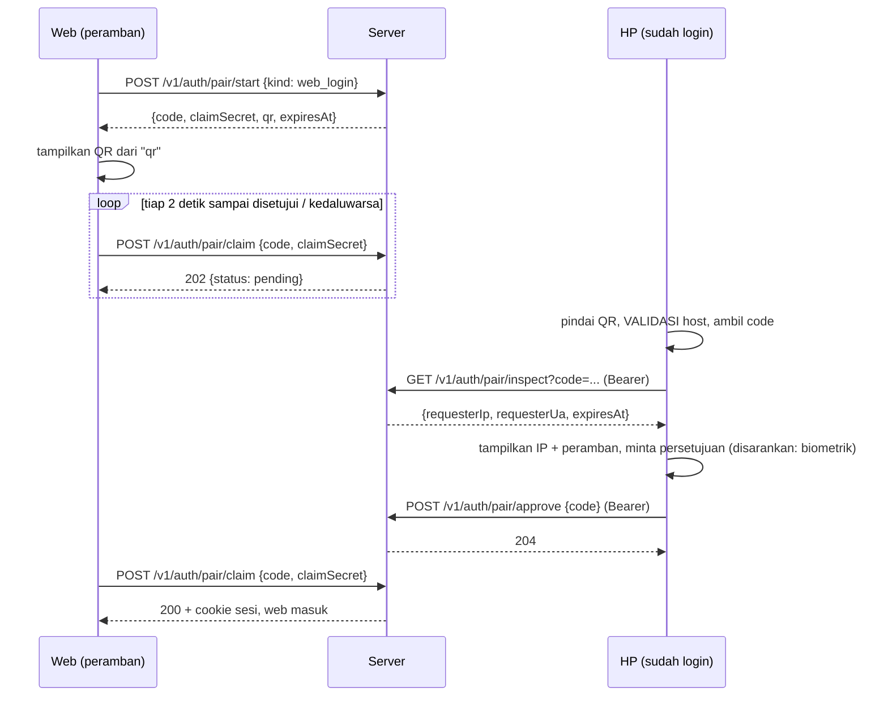
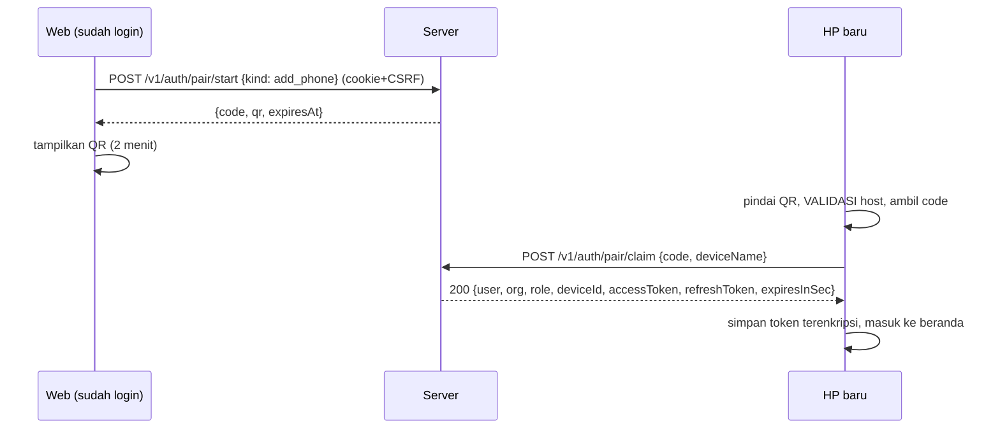
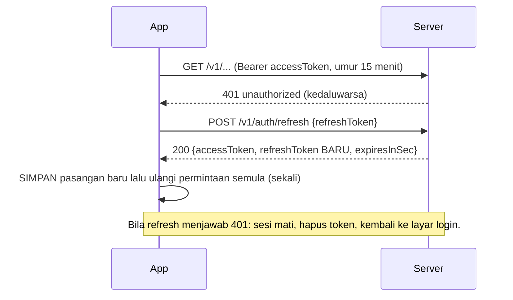

# Login dan pairing QR di aplikasi Android (untuk pengembang Android)

Dokumen serah-terima dari tim server (`inteldes-web`, https://inteldes.at-in.site) ke aplikasi Android
`com.inteldes.app`. Ia menjelaskan **apa yang harus ditambahkan di Android** agar HP bisa (1) masuk ke
server, (2) **memindai QR dari web untuk menyetujui login web**, dan (3) **memindai QR dari web untuk
menambahkan HP baru tanpa mengetik sandi**. Server sudah jadi, ter-deploy, dan teruji; yang kurang
hanya sisi Android.

> **Cara memakai:** `git pull`, baca dokumen ini, kerjakan daftar tugas di bagian 9, dan uji dengan resep
> di bagian 8 (tidak butuh web sama sekali). Kontrak mesin lengkap ada di
> [`openapi.snapshot.yaml`](openapi.snapshot.yaml) (salinan dari repo `inteldes-web`, commit `9019bbd`).
> Bila server berubah, salinan itu diperbarui di repo ini; sumber aslinya `inteldes-web/openapi/openapi.yaml`.

**Status kode di dokumen ini:** potongan Kotlin adalah **ilustrasi yang belum dikompilasi** (tim server
tidak punya Android SDK). Anggap sebagai pola, bukan salinan siap-tempel. Nama paket dan versi pustaka
perlu dicek terhadap proyek.

---

## 1. Gambaran

```
        WEB (peramban)                    SERVER                     HP Android
   ┌───────────────────┐         ┌───────────────────┐        ┌────────────────────┐
   │ Halaman masuk     │         │ /v1/auth/pair/*   │        │ Login (email+sandi)│
   │  [QR login]       │◄───────►│ /v1/auth/login    │◄──────►│ Pindai QR web      │
   │ Perangkat         │         │ /v1/auth/refresh  │        │ Setujui / Klaim    │
   │  [QR tambah HP]   │         │ /v1/auth/me       │        │ Simpan token       │
   └───────────────────┘         └───────────────────┘        └────────────────────┘
```

Ada **dua alur QR** yang berlawanan arah. Jangan tertukar:

| | Alur A: **Masuk web** | Alur B: **Tambah HP** |
|---|---|---|
| Siapa menampilkan QR | Peramban yang belum login | Web yang **sudah login** (admin/operator) |
| Siapa memindai | HP yang **sudah login** | HP **baru** yang belum login |
| Tindakan HP | `inspect` → konfirmasi → `approve` | `claim` (langsung dapat token) |
| Hasil | Web mendapat sesi cookie | HP mendapat `accessToken` + `refreshToken` |
| HP butuh login sebelumnya? | **Ya** (Bearer) | **Tidak** |
| Parameter QR `k` | `web_login` | `add_phone` |

Isi QR (teks biasa, tampilan di web):

```
https://inteldes.at-in.site/pair#c=<code>&k=<web_login|add_phone>
```

Kode ada di **fragmen** (`#…`) sehingga tidak ikut terkirim ke server bila QR dibuka di peramban. `code`
adalah base64url 32 karakter. Berlaku **2 menit**, **sekali pakai**.

## 2. Diagram urutan

### Alur A: HP menyetujui login web



Keamanan alur A: `code` di QR **saja tidak cukup** untuk mengklaim sesi; peramban memegang `claimSecret`
terpisah. Karena itu orang yang memotret QR hanya bisa mengajukan persetujuan dengan akunnya sendiri,
tidak bisa mencuri sesi. Yang menjaga dari "QR palsu di halaman penipu" adalah **layar konfirmasi di HP**
(IP dan peramban pemohon). Layar itu wajib ada.

### Alur B: HP baru memindai QR dari web



Pada alur B **QR itu sendiri adalah kredensial** selama 2 menit (siapa pun yang memindainya lebih dulu
mendapat sesi pengguna pembuat). Karena itu web menampilkan peringatan "jangan bagikan", dan admin bisa
mencabut perangkat kapan saja (`Perangkat` di web). Di Android: tampilkan nama akun yang akan
dimasuki sebelum menyimpan, dan jangan menyimpan kode QR.

### Pembaruan token (semua alur)



Refresh token **berputar**: tiap pemakaian menghasilkan yang baru dan yang lama mati. Memakai token lama
lagi (di luar jendela toleransi 10 detik, mis. dua proses menyegarkan bersamaan) dianggap pencurian dan
**mencabut seluruh perangkat**. Karena itu penyegaran harus **satu per satu (single-flight)** dan hasilnya
**disimpan sebelum** permintaan diulang.

## 3. Kontrak API yang dipakai Android

Basis: `https://inteldes.at-in.site`. JSON UTF-8. Waktu = epoch milidetik. Semua galat berbentuk:

```json
{ "error": { "code": "invalid_credentials", "message": "Email atau sandi salah", "details": null } }
```

Tampilkan `error.message` ke pengguna (sudah berbahasa Indonesia); pakai `error.code` untuk logika.

### Login sandi (alur "masuk biasa")

`POST /v1/auth/login`, tanpa header Authorization.

```json
{ "email": "ani@desa.id", "password": "…", "platform": "android", "deviceName": "Samsung SM-A546E" }
```

`platform` **wajib `"android"`** (bila `web`, server memakai cookie dan tidak mengembalikan token).
`deviceName` opsional, maksimal 100 karakter; isi `"${Build.MANUFACTURER} ${Build.MODEL}"`.

200:

```json
{
  "user": { "id": "uuid", "email": "ani@desa.id", "name": "Ani" },
  "org":  { "id": "uuid", "name": "Desa Tales" },
  "role": "admin",
  "deviceId": "uuid",
  "accessToken": "…",
  "refreshToken": "<uuid>.<rahasia>",
  "expiresInSec": 900
}
```

Galat: `401 invalid_credentials` (email tak dikenal, sandi salah, atau akun nonaktif: pesannya **sengaja
sama**), `403 no_membership`, `400 validation_error`, `429` (maks 10 percobaan/menit per IP).
`role` ∈ `admin | operator | pembaca`; `pembaca` hanya boleh membaca.

### Refresh, profil, logout

| Panggilan | Isi | Hasil |
|---|---|---|
| `POST /v1/auth/refresh` | `{ "refreshToken": "…" }` | `200 { deviceId, accessToken, refreshToken, expiresInSec }`, `401` = sesi mati |
| `GET /v1/auth/me` (Bearer) | – | `200 { user, org, role, deviceId }` |
| `POST /v1/auth/logout` (Bearer) | – | `204`; perangkat dicabut di server |

`accessToken` berlaku **15 menit**; `refreshToken` berlaku **30 hari** sejak diterbitkan dan diperbarui tiap
pemakaian (jadi pengguna aktif tidak perlu login ulang).

Semua panggilan lain memakai `Authorization: Bearer <accessToken>`. **Tidak ada CSRF** untuk Bearer.
Peran dan pencabutan perangkat dibaca server pada **setiap permintaan**, jadi admin yang mencabut HP ini
langsung membuat panggilan berikutnya `401` (dan refresh juga gagal).

### Alur A: inspect dan approve

`GET /v1/auth/pair/inspect?code=<code>` (Bearer) → `200`:

```json
{ "kind": "web_login", "requesterIp": "157.20.126.236", "requesterUa": "Mozilla/5.0 (Windows NT 10.0; …) Edg/156", "createdAt": 1761800000000, "expiresAt": 1761800120000 }
```

`POST /v1/auth/pair/approve` (Bearer) `{ "code": "<code>" }` → `204`.

Galat: `404 pair_invalid` (kode tak dikenal, kedaluwarsa, atau sudah disetujui), `403 phone_required`
(hanya perangkat Android yang boleh menyetujui; tidak akan terjadi bila login memakai `platform:"android"`),
`401` (belum login), `429` (inspect 30/menit, approve 20/menit).

`requesterIp` dan `requesterUa` berasal dari peramban yang menampilkan QR (IP dari header Cloudflare, tidak
bisa dipalsukan klien). Tampilkan keduanya apa adanya.

### Alur B: claim

`POST /v1/auth/pair/claim` (tanpa Authorization) `{ "code": "<code>", "deviceName": "Xiaomi Redmi 12" }` → `200`:

```json
{ "status": "approved", "user": {…}, "org": {…}, "role": "operator", "deviceId": "uuid",
  "accessToken": "…", "refreshToken": "…", "expiresInSec": 900 }
```

Galat: `404 pair_invalid`, `410 pair_expired` (lewat 2 menit atau sudah dipakai), `403 approver_invalid`
(pembuat QR sudah dicabut/nonaktif), `429`. **Jangan mengirim `claimSecret`** pada alur B (itu milik web di alur A).

## 4. Yang harus ditambahkan di Android

Ringkasan perubahan; rinciannya di bagian 5 sampai 7.

| Area | Perubahan |
|---|---|
| `AndroidManifest.xml` | (opsional) izin kamera bila memakai CameraX; App Links untuk `/pair`; aturan backup baru |
| `build.gradle.kts` | `BuildConfig.SERVER_URL`; pustaka pemindai QR |
| `data/network` | klien API auth, `Authenticator` untuk refresh, **matikan log isi** untuk `/v1/auth/*` |
| `data/prefs` | `SessionStore` terenkripsi (token, deviceId, profil) |
| `navigation` | rute `Login`, `ScanPair`, `Account` |
| `ui/screens` | layar Login, Pindai QR, Konfirmasi persetujuan, Akun |
| `ui/screens/settings` | bagian baru "Akun & web" di `SettingsScreen.kt` |

Aplikasi ini **offline-first** dan memakai kunci API sendiri (mode langsung). Login ke server harus
**opsional** pada tahap ini: pengguna yang belum masuk tetap bisa merekam dan memproses secara lokal
seperti sekarang. Sinkron (DB v8, `outbox`, `sync/changes`) adalah pekerjaan terpisah; lihat
`docs/handoff/sync-protocol.md` di repo `inteldes-web`. Dokumen ini hanya mencakup login dan pairing.

## 5. Sketsa layar

```
┌─ Login ────────────────────┐   ┌─ Pindai QR ────────────────┐   ┌─ Setujui masuk web? ───────┐
│  IntelDes                  │   │  ←  Pindai kode QR         │   │  Seseorang meminta masuk   │
│                            │   │ ┌────────────────────────┐ │   │  ke web sebagai Ani        │
│  Email   [______________]  │   │ │                        │ │   │                            │
│  Sandi   [______________]  │   │ │      (kamera)          │ │   │  Dari      157.20.126.236  │
│                            │   │ │                        │ │   │  Peramban  Edge, Windows   │
│  [        Masuk         ]  │   │ └────────────────────────┘ │   │  Berlaku   1:42 lagi       │
│                            │   │  Arahkan ke QR di layar    │   │                            │
│  ───────── atau ─────────  │   │  komputer atau HP lain.    │   │  Setujui hanya bila ini    │
│  [ Pindai QR dari web  ]   │   │                            │   │  perangkat Anda sendiri.   │
│                            │   │                            │   │  [Tolak]      [ Setujui ]  │
│  Lewati (mode lokal)       │   │                            │   │   (minta sidik jari/PIN)   │
└────────────────────────────┘   └────────────────────────────┘   └────────────────────────────┘

┌─ Pengaturan > Akun & web ──┐
│  AKUN & WEB                │
│  Masuk sebagai Ani · Admin │
│  Desa Tales                │
│  [ Masuk web dengan QR ]   │   → ScanPair(mode = APPROVE)
│  [ Keluar dari server  ]   │   → POST /logout lalu hapus token
└────────────────────────────┘
```

Alur layar:

- **Login** → `POST /login` → simpan sesi → beranda. Tombol "Pindai QR dari web" → `ScanPair(mode = CLAIM)` (alur B).
- **Pengaturan > Masuk web dengan QR** → `ScanPair(mode = APPROVE)` (alur A). Hanya muncul bila sudah login.
- Satu pemindai, dua mode. Mode ditentukan **pengguna** (tombol yang ditekan), lalu **dicocokkan dengan `k` di QR**.
  Bila tidak cocok (mis. mode APPROVE tetapi QR `add_phone`), tolak dengan pesan jelas; jangan menebak.

## 6. Pemindaian dan validasi QR

### Pustaka

Disarankan **Google Code Scanner** (`com.google.android.gms:play-services-code-scanner`; cek versi terbaru).
Pemindai berjalan di Play services, sehingga **tanpa izin `CAMERA` dan tanpa kode CameraX**; aplikasi ini
sudah memakai Play services (`play-services-auth`). Bila perangkat target tidak punya Play services, ganti
dengan CameraX + `com.google.mlkit:barcode-scanning` (butuh izin `CAMERA` runtime dan
`<uses-feature android:name="android.hardware.camera" android:required="false" />`).

```kotlin
// ILUSTRASI, belum dikompilasi.
val options = GmsBarcodeScannerOptions.Builder()
    .setBarcodeFormats(Barcode.FORMAT_QR_CODE)
    .build()
GmsBarcodeScanning.getClient(context, options)
    .startScan()
    .addOnSuccessListener { barcode -> onScanned(barcode.rawValue.orEmpty()) }
    .addOnCanceledListener { /* pengguna menutup */ }
    .addOnFailureListener { /* tampilkan "Pemindai tidak tersedia" */ }
```

### Validasi WAJIB sebelum memanggil API apa pun

Pindai hanya **membaca teks**; tidak ada yang dipercaya sampai lolos validasi. Ini menutup QR palsu yang
mengarah ke server lain:

```kotlin
// ILUSTRASI, belum dikompilasi.
data class PairingLink(val code: String, val kind: Kind) {
    enum class Kind { WEB_LOGIN, ADD_PHONE }

    companion object {
        private val CODE = Regex("^[A-Za-z0-9_-]{20,80}$")

        fun parse(raw: String, serverUrl: String = BuildConfig.SERVER_URL): PairingLink? {
            val uri = runCatching { java.net.URI(raw.trim()) }.getOrNull() ?: return null
            val server = java.net.URI(serverUrl)
            if (uri.scheme != "https") return null                         // tolak http, intent:, dll.
            if (!uri.host.equals(server.host, ignoreCase = true)) return null // HARUS server kita
            if (uri.port != -1 && uri.port != 443) return null
            if (uri.path != "/pair") return null
            val frag = uri.rawFragment ?: return null
            val q = frag.split('&').mapNotNull { it.split('=', limit = 2).takeIf { p -> p.size == 2 } }.associate { it[0] to it[1] }
            val code = q["c"]?.takeIf { CODE.matches(it) } ?: return null
            val kind = when (q["k"]) { "web_login" -> Kind.WEB_LOGIN; "add_phone" -> Kind.ADD_PHONE; else -> return null }
            return PairingLink(code, kind)
        }
    }
}
```

Uji unit untuk `parse` (wajib): host lain, `http://`, subdomain mirip (`inteldes.at-in.site.evil.com`,
`evil.com/inteldes.at-in.site`), kode terlalu pendek/berkarakter aneh, `k` tak dikenal, tanpa fragmen, port
aneh, spasi di awal/akhir.

### App Links (opsional, kenyamanan)

Bila QR dipindai oleh **aplikasi kamera bawaan**, tanpa App Links yang terverifikasi tautan itu terbuka di
peramban (halaman penjelasan `/pair`). Dengan App Links, aplikasi langsung terbuka:

```xml
<!-- di <activity android:name=".MainActivity"> (launchMode singleTop: tangani juga onNewIntent) -->
<intent-filter android:autoVerify="true">
    <action android:name="android.intent.action.VIEW" />
    <category android:name="android.intent.category.DEFAULT" />
    <category android:name="android.intent.category.BROWSABLE" />
    <data android:scheme="https" android:host="inteldes.at-in.site" android:pathPrefix="/pair" />
</intent-filter>
```

Lalu server harus menyajikan `https://inteldes.at-in.site/.well-known/assetlinks.json` berisi sidik jari
sertifikat penandatangan. **Tim server menunggu nilai ini dari Anda:**

```json
[{ "relation": ["delegate_permission/common.handle_all_urls"],
   "target": { "namespace": "android_app", "package_name": "com.inteldes.app",
               "sha256_cert_fingerprints": ["AA:BB:…(SHA-256 sertifikat rilis)"] } }]
```

Ambil sidik jari dari keystore rilis (`keytool -list -v -keystore <file>`) atau, bila memakai Play App Signing,
dari Play Console > Integritas aplikasi. Kirim sidik jarinya (bukan keystore) ke pemilik server; berkasnya
ditaruh di `web/public/.well-known/assetlinks.json` pada repo `inteldes-web`. Saat menerima intent dari App
Link, jalankan `PairingLink.parse` **sama persis** seperti hasil pemindaian dalam aplikasi.

## 7. Klien API, sesi, dan keamanan

### Konfigurasi build

```kotlin
// app/build.gradle.kts, di defaultConfig (sejajar dengan EMBEDDED_*_KEY)
buildConfigField("String", "SERVER_URL", "\"https://inteldes.at-in.site\"")
```

### Penyimpanan sesi

Pakai pola yang sama dengan `SecurePrefs` (`EncryptedSharedPreferences`, AES256). Simpan: `accessToken`,
`accessExpiresAtMs`, `refreshToken`, `deviceId`, profil (`name`, `email`, `orgName`, `role`).
**Jangan** menyimpan sandi, kode QR, atau `claimSecret`.

**Cadangan (backup):** `res/xml/backup_rules.xml` saat ini hanya mengecualikan `secure_prefs.xml` dan hanya
berlaku di Android 11 ke bawah (`fullBackupContent`). Aplikasi menarget SDK 34, jadi pada Android 12+ aturan itu
**diabaikan**. Tambahkan `android:dataExtractionRules="@xml/data_extraction_rules"` yang mengecualikan berkas
sesi (dan `secure_prefs.xml`) dari cloud backup dan device transfer, serta kecualikan juga di `backup_rules.xml`.
Token sesi tidak boleh dipulihkan ke perangkat lain.

### Interceptor dan Authenticator (OkHttp 4.12, sudah dipakai)

```kotlin
// ILUSTRASI, belum dikompilasi.
class BearerInterceptor(private val session: SessionStore) : Interceptor {
    override fun intercept(chain: Interceptor.Chain): Response {
        val req = chain.request()
        val token = session.accessToken ?: return chain.proceed(req)
        return chain.proceed(req.newBuilder().header("Authorization", "Bearer $token").build())
    }
}

class RefreshAuthenticator(private val session: SessionStore, private val api: AuthApi) : Authenticator {
    private val lock = Any()
    override fun authenticate(route: Route?, response: Response): Request? {
        if (response.request.url.encodedPath.startsWith("/v1/auth/refresh")) return null
        if (response.priorResponse != null) return null                  // sudah dicoba sekali
        synchronized(lock) {                                              // SINGLE-FLIGHT
            val sent = response.request.header("Authorization")?.removePrefix("Bearer ")
            val current = session.accessToken
            if (current != null && current != sent) {                     // proses lain sudah menyegarkan
                return response.request.newBuilder().header("Authorization", "Bearer $current").build()
            }
            val refresh = session.refreshToken ?: return null
            val fresh = runCatching { api.refresh(refresh) }.getOrNull()
            if (fresh == null) { session.clear(); SessionEvents.emitLoggedOut(); return null }  // 401 = sesi mati
            session.save(fresh)                                           // SIMPAN dulu...
            return response.request.newBuilder().header("Authorization", "Bearer ${fresh.accessToken}").build() // ...baru ulangi
        }
    }
}
```

Bila penyegaran gagal karena **jaringan** (bukan 401), jangan menghapus sesi; biarkan galat jaringan biasa.
Hanya `401` dari `/v1/auth/refresh` yang mengakhiri sesi.

### Larangan dan kewajiban keamanan

1. **Validasi host QR** (bagian 6) sebelum memanggil API apa pun.
2. **Jangan mencatat** kode QR, token, atau sandi. Dependensi `logging-interceptor` sudah ada; pastikan
   levelnya **`NONE` di build rilis**, atau samarkan header `Authorization` dan jangan mencatat badan
   `/v1/auth/*`. Jangan menaruhnya di Logcat, Crashlytics, atau pesan galat yang ditampilkan.
3. HTTPS saja: tambahkan `android:usesCleartextTraffic="false"` (atau Network Security Config) dan jangan
   menonaktifkan verifikasi TLS.
4. Layar konfirmasi alur A **wajib** menampilkan `requesterIp` dan `requesterUa`, dan sebaiknya meminta
   biometrik/PIN (`BiometricPrompt`) sebelum `approve`. Pasang `FLAG_SECURE` pada layar itu.
5. Satu permintaan terbang sekaligus untuk `approve`/`claim` (cegah ketuk ganda). `claim` bersifat satu kali:
   bila respons hilang setelah server memprosesnya, pengguna harus membuat QR baru (jelaskan lewat pesan `410`).
6. Hanya satu sesi per instalasi. Login baru atau `claim` baru menggantikan sesi lama; bila ada sesi lama,
   panggil `logout` (abaikan galatnya) agar perangkat lama di server tidak menggantung.
7. Pada logout: `POST /v1/auth/logout` (best-effort), lalu hapus semua isi `SessionStore`.

### Peta galat ke perilaku

| Kode / status | Artinya | Perilaku aplikasi |
|---|---|---|
| `401 invalid_credentials` | email/sandi salah atau akun nonaktif | tampilkan pesan; jangan bedakan penyebab |
| `403 no_membership` | akun belum masuk organisasi | tampilkan pesan, hubungi admin |
| `429` | terlalu banyak percobaan | tampilkan "coba lagi sebentar"; jangan mengulang otomatis |
| `404 pair_invalid` | kode tak dikenal / sudah dipakai / sudah disetujui | "Kode tidak berlaku. Buat kode baru di web." |
| `410 pair_expired` | lewat 2 menit atau sudah diklaim | "Kode kedaluwarsa. Buat kode baru di web." |
| `403 phone_required` | menyetujui dari sesi bukan-Android | seharusnya tidak muncul; laporkan sebagai bug |
| `403 approver_invalid` | pembuat QR sudah dicabut | "Perangkat penyetuju tidak lagi sah." |
| `401` pada panggilan biasa | akses kedaluwarsa | Authenticator menyegarkan; bila gagal → layar login |
| galat jaringan | offline / DNS / timeout | pesan jaringan; sesi tetap |

## 8. Cara menguji tanpa web (resep curl)

Server produksi bisa dipakai langsung. Semua contoh memakai `curl`; ganti host bila Anda diberi staging.
Batas laju: `start` 20/menit, `inspect` 30/menit, `approve` 20/menit, `login` 10/menit per IP.

**Alur A (HP menyetujui login web).** Anggap web yang belum login:

```bash
# 1. "Web" membuat kode (simpan code dan claimSecret)
curl -s -X POST https://inteldes.at-in.site/v1/auth/pair/start \
  -H 'content-type: application/json' -d '{"kind":"web_login"}'
# → {"code":"…","claimSecret":"…","qr":"https://inteldes.at-in.site/pair#c=…&k=web_login","expiresAt":…}

# 2. Ubah nilai "qr" menjadi gambar lalu pindai dengan aplikasi Anda (alat apa saja, mis. qrencode):
qrencode -t ANSIUTF8 'https://inteldes.at-in.site/pair#c=…&k=web_login'

# 3. Setelah HP menyetujui, "web" menukar kode dengan sesi (200 + Set-Cookie). Sebelum itu: 202 pending
curl -i -X POST https://inteldes.at-in.site/v1/auth/pair/claim \
  -H 'content-type: application/json' -d '{"code":"…","claimSecret":"…"}'
```

**Alur B (HP baru memindai QR dari web yang sudah login).** Butuh sesi admin/operator; paling mudah
lewat token Android:

```bash
# 1. Masuk sebagai operator/admin (platform android supaya dapat Bearer)
curl -s -X POST https://inteldes.at-in.site/v1/auth/login -H 'content-type: application/json' \
  -d '{"email":"…","password":"…","platform":"android","deviceName":"curl"}'
# 2. Buat kode tambah HP dengan Bearer itu
curl -s -X POST https://inteldes.at-in.site/v1/auth/pair/start \
  -H 'content-type: application/json' -H 'authorization: Bearer <accessToken>' -d '{"kind":"add_phone"}'
# 3. Pindai QR dari "qr" dengan aplikasi (HP BELUM login) → aplikasi memanggil /pair/claim
```

Perhatian: kode `add_phone` berlaku 2 menit dan sekali pakai; buat kode baru untuk tiap percobaan.

**Memeriksa hasil:** `GET /v1/auth/me` dengan token baru harus mengembalikan akun yang benar. Admin dapat
melihat dan mencabut perangkat di web (menu Perangkat); setelah dicabut, `GET /v1/auth/me` dan
`POST /v1/auth/refresh` dari HP itu harus `401` dan aplikasi harus kembali ke layar login.

**Akun uji:** pengguna dibuat oleh admin server (`npm run admin:create` di server); belum ada layar
manajemen pengguna. Minta pemilik server membuatkan akun uji dengan peran `operator`.

## 9. Daftar tugas dan kriteria selesai

- [ ] `SERVER_URL` di `BuildConfig`; HTTPS saja.
- [ ] `SessionStore` terenkripsi + aturan backup untuk Android 12+ (`dataExtractionRules`).
- [ ] Klien auth (`login`, `refresh`, `me`, `logout`, `inspect`, `approve`, `claim`) memakai `HttpClient` yang ada.
- [ ] `BearerInterceptor` + `RefreshAuthenticator` single-flight; token baru disimpan sebelum mengulang.
- [ ] Log isi dimatikan/disamarkan untuk `/v1/auth/*` di build rilis.
- [ ] `PairingLink.parse` + uji unit (bagian 6).
- [ ] Layar Login (sandi) dan "Lewati (mode lokal)"; aplikasi tetap berfungsi tanpa login.
- [ ] Layar Pindai QR dengan dua mode; mode dicocokkan dengan `k`.
- [ ] Layar konfirmasi alur A: IP dan peramban, hitung mundur, biometrik/PIN, `FLAG_SECURE`.
- [ ] Bagian "Akun & web" di Pengaturan; logout.
- [ ] (Opsional) App Links + kirim sidik jari sertifikat ke pemilik server.
- [ ] Penanganan semua kode galat di tabel bagian 7.

**Selesai bila:** (1) login sandi berhasil dan sesi bertahan setelah aplikasi dimatikan; (2) QR web disetujui
dari HP dan peramban otomatis masuk, termasuk bila IP/peramban ditampilkan benar; (3) HP baru yang belum login
memindai QR `add_phone` dan langsung masuk tanpa mengetik sandi; (4) QR berisi host lain ditolak tanpa satu
pun permintaan jaringan; (5) setelah admin mencabut perangkat, aplikasi kembali ke layar login; (6) dua
panggilan bersamaan saat token kedaluwarsa hanya menghasilkan **satu** `refresh`.

## 10. Hal lain yang perlu diketahui

- Peran: `admin` > `operator` > `pembaca`. Sembunyikan aksi tulis untuk `pembaca` (server tetap menolak `403`).
- Server juga sudah menyediakan sinkron (`GET /v1/sync/changes`, `PUT /v1/recordings/:id` dengan `If-Match`),
  unggah audio resumable (tus) dan pemrosesan AI di server. Itu **belum** dipakai Android; rencana dan
  perubahan DB v8 ada di `docs/handoff/sync-protocol.md` dan `api-contract.md` (repo `inteldes-web`).
- Hasil notulensi dari server memakai bentuk payload **yang sama persis** dengan `SectionCodec.kt`, sehingga
  nanti bisa dibaca langsung oleh aplikasi.
- Pertanyaan atau perubahan kontrak: hubungi pemilik server; perubahan API selalu disertai pembaruan
  `openapi.snapshot.yaml` di repo ini.
